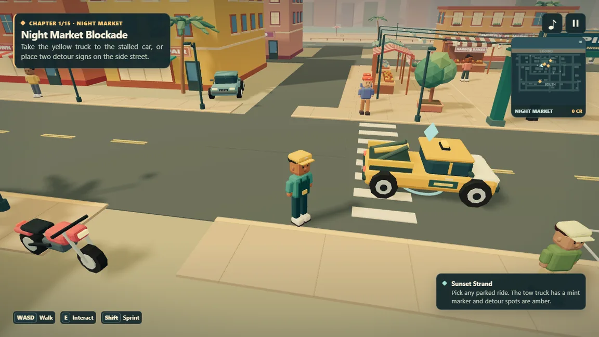
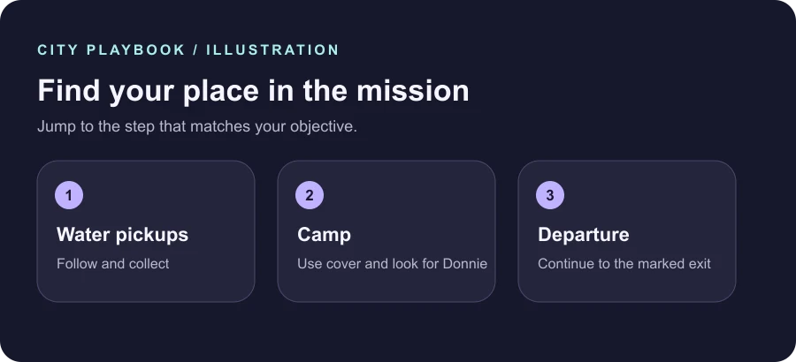

# Grand City Auto VI

[Visit Grand City Auto VI](https://grandcityautovigame.com/) to play our original 3D city sandbox or look up a setting, save or mission objective in the independent **GTA VI** guide library.

## Play Market Shift

Explore Sunset Strand, try different vehicles and choose whether to tow a stalled car or set up a detour in the opening mission. [Play Grand City Auto VI online for free](https://grandcityautovigame.com/play/grand-city-auto-vi/).

## Find a GTA VI guide

The guide library accepts mission names, menu terms and common spelling variations. Guides include low-spoiler summaries, credited screenshots, original step diagrams and a checklist stored in your browser.

- [Browse the guide library](https://grandcityautovigame.com/guides/gta-vi/)
- [Find subtitles and controller settings](https://grandcityautovigame.com/guides/gta-vi/settings/)
- [Make or load a manual save](https://grandcityautovigame.com/guides/gta-vi/how-to-save/)
- [Find your next Gone Fishing objective](https://grandcityautovigame.com/guides/gta-vi/missions/gone-fishing/)
